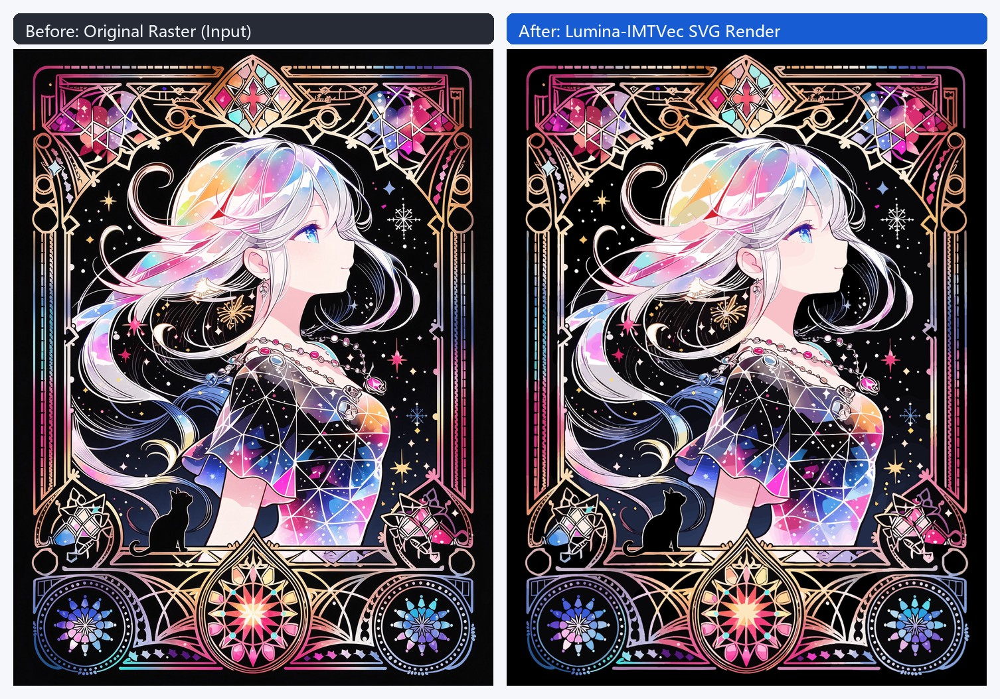
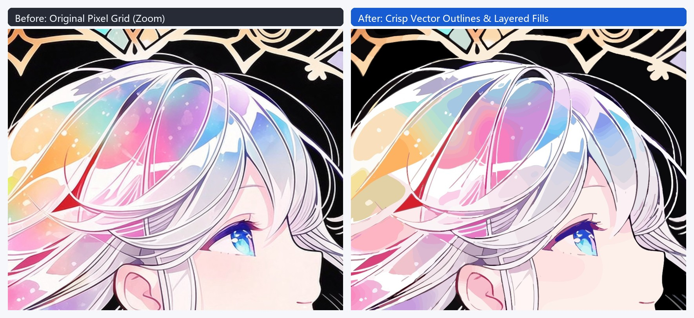
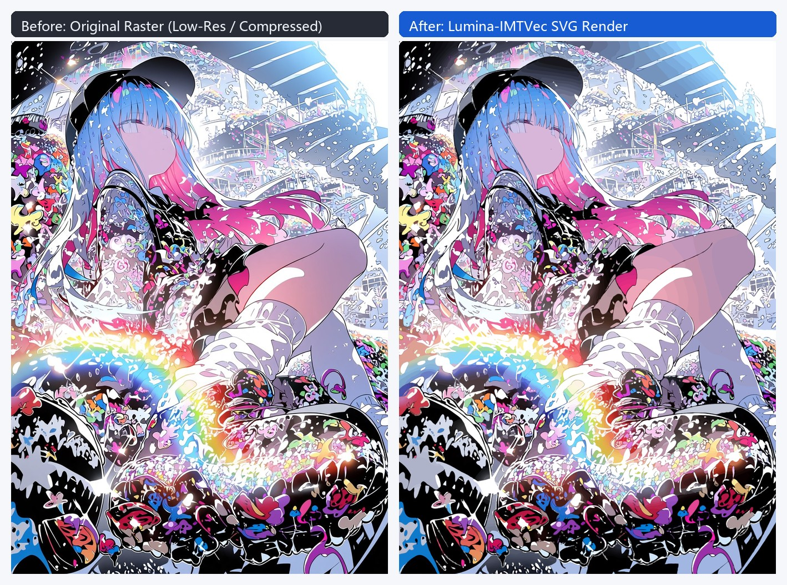
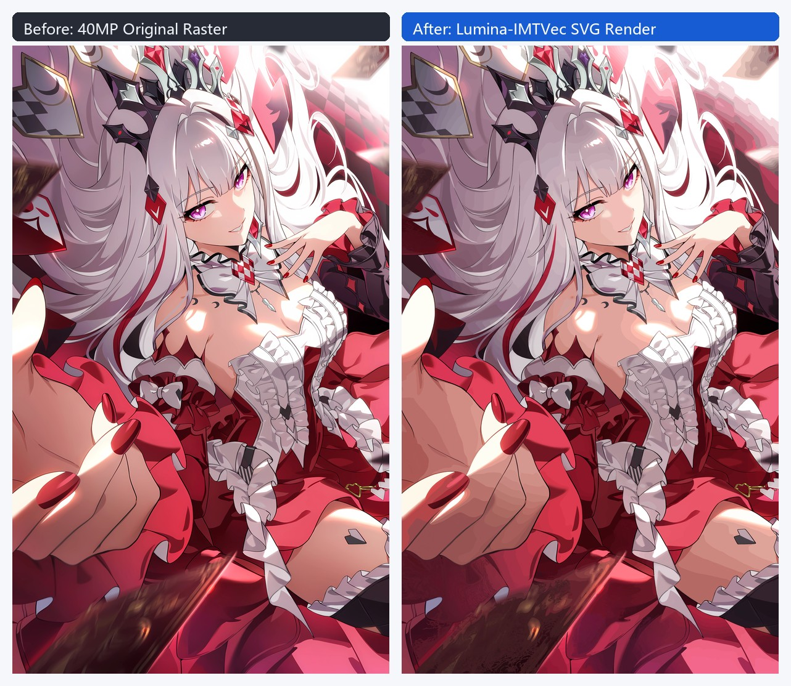

# Lumina-IMTVec

**面向 3D 打印叠色打印（Multi-Color Layer-Stack 3D Printing）的高精度图像转分层矢量路径引擎**  
专为配合 **Lumina 叠色打印软件** 将二次元插画与高复杂度平面图像转化为可直接进行分层路径规划的干净双层矢量 SVG 而设计。

---

## 一、 原项目致谢（Acknowledgements）

本项目最初参考并基于开源项目 **Lumina-Vec**（`0.9.2` 候选版）的工程骨架进行深度二次开发。  
在演进过程中，**Lumina-IMTVec** 的核心算法、神经网络路由与矢量分割管线已经历了全面推倒与重构（包括多模型 ONNX 协同体系、`LineVectorNet` / `ElementGradNet` / `DefectRepairNet`、无损平面闭合轮廓分割管线 `planar_partition`、保护区解锁合并及大尺寸分块防爆内存机制等），在转换理念、结构形态与代码主体上与原项目已产生根本性差异；但 **Web 前端交互界面框架**（`webui.py`、`index.html` 的轻量化本地异步任务流与双图对比预览机制）以及 **后端部分共享边界建图与曲线拟合思路**（`shared_regions`、`structural_curves` 与几何防自交约束）借鉴并延续了 **Lumina-Vec** 的优秀工程设计。

在此向原项目 **Lumina-Vec** 及其作者致以由衷的感谢！

---

## 二、 核心设计目的与 SVG 转换思路

传统图像矢量化工具（或早期栅格量化拼接方案）往往采用“全局颜色聚类 + 多层色块前后遮盖堆叠”的方式来逼近视觉效果——这种方式在**平面屏幕浏览**时看似完整，但在导入 **3D 叠色打印（Lumina 叠色打印软件）** 进行**按色分层厚度映射与物理打印路径规划**时会带来严重问题：
- **细微线条断续或坍缩**：抗锯齿边界像素在聚类后变成 1px 碎点或被清理算法误删，导致打印成型的关键轮廓与细发丝断裂、无法形成实体支撑或物理分界；
- **多层色块相互堆叠**：上下层色区互相穿透覆盖，造成切片软件重复计算层厚、色彩顺序错乱、多余耗材切换与内部空腔伪影；
- **渐变区碎化爆炸**：连续平滑渐变被强行切成数以十万计的细碎微区，超出切片软件路径处理上限，同时小缝隙色块也被强行分成多色杂斑。

为此，**Lumina-IMTVec** 确立了明确的两级核心目标与严格的单向流水线设计：

### 1. 第一要务：以完整矢量路径高精度描绘线条轮廓
- **热力无损直转闭合线条带**：拒绝将连续线条通过 `posterize -> simplify -> speckle` 切碎后再尝试拼接，而是直接由 9 通道 `LineVectorNet` 提取 2× 超分分辨率下的闭合线条带状轮廓；
- **断点闭合与拓扑连通**：对线条脊线配合一维谷底特征进行提取，自动桥接对角 4 连通壁垒并封闭 `1~4px` T 型/拐角微缺口，在骨架中心线上平滑分色并 Voronoi 传播，使每一根纤细发丝、睫毛与装饰线框都以**连续、不断裂、真实宽度**的矢量轮廓完整保留。

### 2. 第二要务：轮廓约束的平面分割与可控色彩量化（完美适配叠色打印）
- **100% 互不重叠的平面封闭分割（Planar Disjoint Partition）**：产出严格遵循双层/三层对应规范的 **Teacher SVG 平面结构**：
  - **底层轮廓补缝层（`#region-boundaries` / `region-gap-filler`）**：与填充层共用完全一致的平滑贝塞尔/圆弧几何路径，仅以 `stroke-width="2" vector-effect="non-scaling-stroke"` 消除浏览器/切片预处理的亚像素渲染缝；
  - **线稿矢量层（`#line-art-layer`）** + **轮廓约束单色填充层（`#region-colours`）**：整张画面被线稿轮廓与色阶轮廓彻底切分为互不重叠的闭合多边形集合，**每个闭合图形内部有且仅有唯一一种纯色（`fill-rule="evenodd" stroke="none"`）**，绝不存在多层色块相互叠压遮挡。
- **精细分域量化策略**：
  - **小区块与狭缝纯色化**：借助最大内切半径与面积双重判定，所有狭小封闭发丝缝隙与装饰微区一律锁定单一纯色，不产生噪点斑驳；
  - **开阔渐变色阶轮廓分阶**：仅针对 `ElementGradNet` 识别的大面积开阔渐变域划分 3~10 阶可控渐变带，并利用 MBO 曲率平滑将阶跃边界转化为干净顺滑的矢量色阶轮廓线（面部柔和腮红收敛为单根光滑弧线）；
  - **路径规模高度可控**：常规二次元插画输出约 **6,000 ~ 13,000 条** 干净闭合路径（相比传统碎化管线约 15 万条路径缩减 **10~15 倍**），直接适配 **Lumina 叠色打印软件** 的分层导入与路径生成。

---

## 三、 效果对比（SVG 处理前后）

> 所有结果均为真实插画经 **Lumina-IMTVec** 纯 ONNX 推理管线导出双层 SVG 后，经无头 Chromium 真实矢量光栅化与原画对比（点击可查看大图）：

### 1. 复杂彩窗二次元插画 · 整体结构还原（`tarot`）


### 2. 细节放大对比 · 5× 纤细发丝、睫毛与高光层次（`tarot`）

- **左图（原图光栅）**：高倍率放大后可见锯齿边缘、JPG 涂抹糊边与半透明渐变杂色。
- **右图（Lumina-IMTVec SVG）**：连续不断裂的贝塞尔矢量细发丝、干净收敛的渐变色阶与 100% 互不重叠的单色封闭色块，可直接导入 **Lumina 叠色打印软件** 按色分层切片。

### 3. 复杂流行插画 · 无描边硬软边缘协同分割（`e9630244`）

- 霓虹高对比阴影、服饰碎片图案及无黑框柔和肤/眼界均被精准锁定在独立封闭色域内。

### 4. 40MP 超高清大图（`4904 × 8192`）· 分块守护免爆内存（`4322ad13`）

- 配合 `vram_guard.py` 动态显存限额与分块混色护栏，百兆像素级插画可在有限显存下稳健完成矢量分色输出。

---

## 四、 技术架构与五段式流水线

完整技术规范永久留档于 [ARCHITECTURE_SPEC.md](ARCHITECTURE_SPEC.md)，核心执行顺序如下：

1. **Stage 1：前处理与多模型 CNN 协同识别（`feature_routing.py`）**
   - 依据原图分辨率自适应执行超分增强（`realesr_anime.onnx`；常规插画 2×/5×，对于已达 `10 MP` 以上的 `4K~8K` 大图自动锁定 `1.0×` 工作尺度防内存膨胀）与 95% 色彩去杂平滑；
   - 执行 **OKLab 低频色调锚定（`_restore_tone_1x`）**，消除超分模型带来的皮肤白曝与色度衰减，忠实还原原画曝光与肤色；
   - 运行 `DefectRepairNet`（512 行分块混合 `_blend_chunked_u8`，彻底规避百兆像素级 OOM）、`FeaturePartUNet`、`SurfaceStyleNet`、`ElementGradNet` 与 `LineVectorNet`：
     - `ElementGradNet` 先以低算力粗划渐变域并向内收缩 95% 形成 `grad_core_95`，外围留出 5% 缓冲区 `line_buffer_5`；同时对跨 `2px~4px` 真彩色阶边界（如无黑框眼白/虹膜与肤色交界）设置 `edge_guard` **防越界保护**，防止渐变 CNN 屏蔽线条 CNN。
2. **Stage 2：无损线稿闭合轮廓构建（`planar_partition.py` `_extract_closed_line_mask`）**
   - 仅利用 `LineVectorNet ch0` 执行共线谷底补断（严禁混入 `ch1 color_bound` 形成黑边），经 4 连通桥接与端点闭合得到封闭 `line_mask`，并在中心骨架上分色合并锯齿微段。
3. **Stage 2B → 2.5：轮廓引导分水岭与缓冲区双侧判定解锁（`planar_partition.py`）**
   - 通过局部一维步长极大值脊线判据 `is_step_ridge`（对比 `±2*l_sc` 与 `±4*l_sc` 跨距），精准捕捉无描边柔和色界（如眼白下缘水平微弧）且不切断平滑线性渐变，一次性消除 1~2px 抗锯齿过渡碎边；
   - 线条 CNN 完成后通过 `_process_line_buffer_5` 对 `line_buffer_5` 分别采样内侧渐变核与外侧边缘色彩：独立纯色边保持独立纯色，渐变延伸区则与 `grad_core_95` 重新合一（且严禁跨越 `Stage 2B` 已切分的独立色区如无框眼白/唇彩），保证外围渐变色阶紧贴并严格闭合于首层线条。
4. **Stage 3：渐变色阶轮廓划分（`_band_gradients_and_blush`）**
   - 仅在受内切半径与面积认证的开阔平滑渐变区内部沿主色轴量化分阶，并通过高斯 MBO 曲率流光滑处理，形成自然衔接的闭合渐变色阶边界。
5. **Stage 4：单区唯一纯色填充与矢量曲线拟合（`print_partition.py` `trace_regions`）**
   - 对所有闭合分区排除边缘 1~2px 抗锯齿污染后采集单一中位纯色；
   - 全部曲线拟合在矢量边界图上进行：依次执行 `compact_fragments`、`SourceCorridor` 原图亚像素定位、三阶段结构曲线拟合（`fit_compact_outline` / `refit_sketch_chain` / `smooth_outline_junctions`）及 `geometry_guard` 无自交校验，最终经 `svg_layers.boundary_then_fill` 输出双层矢量 SVG。

---

## 五、 端到端实测验证

基于真实图生矢量并通过 Edge 无头 Chromium 光栅化对比原图实测（2026-11-22）：

| 测试样本 | 输入分辨率 | 缩放档位 | 闭合区域数（与 `gap-filler` 一一对应） | SVG 体积 | 渲染 `2x->1x` PSNR / 关键表现 |
| --- | --- | --- | --- | --- | --- |
| `tarot` | `1333 × 1769` | `2x` | **11,289**（`4,154` 线条 + `7,135` 填充） | `11.08 MB` | 较旧碎化管线 `147,964` 路径缩减 **~13×**，`edgeF1 = 0.9462`，肤色零过曝 |
| `tarot` | `1333 × 1769` | `5x` | **10,436**（`3,267` 线条 + `7,169` 填充） | `11.88 MB` | **24.30 dB**（Preview `25.88 dB`，`edgeF1 = 0.9503`），5x 斜向细发丝连续无虚断 |
| `e9630244` | `928 × 1312` | `2x` | **14,155**（`3,434` 线条 + `10,721` 填充） | `12.50 MB` | 无框眼白 `[202, 197, 234]` 与原图 `[203, 197, 235]` 一致，下眼缘平直微弧精准还原 |
| `4322ad13`（超高清） | `4904 × 8192`（40.17 MP） | 自适应 `1x` | **57,771** | `46.12 MB` | 分块混合与分辨率护栏防 OOM 一次跑通（`415.6s`），发丝、紫瞳与褶皱渐变完整 |

---

## 六、 快速启动与部署（纯 ONNX，免安装 PyTorch / 免用户训练）

本项目已将全部特征识别与超分模型固化为轻量化 ONNX 权重并随仓库内置（`weights/*.onnx`，总计仅约 **20.54 MB**）。**普通用户无需安装数 GB 的 PyTorch / CUDA Toolkit，也无需自行训练或额外下载模型权重。**

### 1. 环境初始化（Windows 推荐 DirectML 通用 GPU 加速）

```powershell
# 自动创建 .venv 并安装纯 ONNX DirectML 运行环境（兼容 NVIDIA / AMD / Intel 显卡）
powershell -ExecutionPolicy Bypass -File scripts\setup_windows.ps1

# 如需强制纯 CPU 部署（无独显或核显显存极小机器）
powershell -ExecutionPolicy Bypass -File scripts\setup_windows.ps1 -CpuOnly
```

安装依赖亦支持 `pip install -r requirements-native.txt` 或以标准 Python 包安装：`pip install -e .`（见 [pyproject.toml](pyproject.toml)）。

### 2. 动态 GPU 显存自适应守护（`lumina_vec/vram_guard.py`）

为防止低显存显卡（如 `2 GB / 4 GB / 6 GB`）或小内存电脑在处理高清大图时出现显存溢出或 OOM 崩溃，推理引擎会在运行前通过 Windows DXGI / `nvidia-smi` 与可用系统内存自动计算安全运行档位：
- **分档动态缩放**：自动下调超分平铺尺寸 `sr_tile`（`384 -> 256 -> 192 -> 128 px`）、表面特征推理批大小 `surface_batch`（`32 -> 24 -> 16 -> 8`）与最大工作像素上限；
- **按阶段及时释放显存**：在显存紧张设备（`< 7.5 GB` 可用预算）上自动开启逐阶段卸载 ONNX Session，绝不同时常驻 7 个模型；
- **无感 CPU 回退**：当 DirectML / CUDA 抛出分配失败或显存不足异常时，自动释放显存会话并无缝切换 `CPUExecutionProvider` 完成当前阶段；
- **手动微调环境变量**（可选）：
  - `LUMINA_VRAM_LIMIT_GB=2.5`：显式限制 GPU 可用显存预算（单位 GB）；
  - `LUMINA_FORCE_CPU=1`：强制全程使用 CPU 推理。

### 3. Web UI 一键启动（推荐）

默认端口 `8091`，浏览器访问 <http://127.0.0.1:8091>：

```powershell
# PowerShell 启动（自动定位 .venv、ONNX 权重与 data 目录）
powershell -ExecutionPolicy Bypass -File scripts\start.ps1

# 或批处理启动（支持自定义端口）
scripts\start_web.bat --port 8091
```

在 Web 界面选择默认预设 **「双层矢量（`print-regions`）」**，转换完成后可在预览栏切换 **「双层 / 仅线稿 / 仅着色」** 检查结构，直接下载 `.svg` 导入 **Lumina 叠色打印软件**。

### 4. 命令行调用（CLI）

```powershell
# 主线推荐：面向叠色打印的平面双层矢量（CNN 特征路由 + 纯净色阶 + SVG 边界平滑）
python -m lumina_vec.pipeline input.png output.svg --preset print-regions

# 显式指定 5x 细节复检倍率（适合超精细发丝/密集饰品原画）
python -m lumina_vec.pipeline input.png output.svg --structure print-regions --gradient-mode clean --smooth-lines --sr-scale 5

# 严格纯黑白线稿无损像素描摹
python -m lumina_vec.pipeline ink.png ink.svg --structure print-regions --no-ai
```

---

## 七、 目录结构

```text
Lumina-IMTVec\
├─ webui.py, index.html               WebUI 服务与前端交互界面（Flask + Waitress + 独立 Worker 子进程）
├─ pyproject.toml                     Python 工程与打包元数据（lumina-imtvec 1.0.0）
├─ requirements-native.txt            纯 ONNX 原生运行依赖清单（零 PyTorch）
├─ README.md                          项目说明、效果展示与部署指南
├─ ARCHITECTURE_SPEC.md               核心架构规范与回归基准永久留档
├─ CHANGELOG.md                       版本演进日志
├─ lumina_vec\                        核心图像处理与矢量引擎包
│   ├─ planar_partition.py            无损平面双层分区主引擎（Stage 2 -> 2.5 -> 3 -> 4）
│   ├─ print_partition.py             vectorize_print 主入口与 SVG 矢量追踪集成
│   ├─ feature_routing.py             ONNX 多模型协同推理、40MP 分块混合防 OOM 与 OOM 回退机制
│   ├─ vram_guard.py                  零 PyTorch 硬件探测与动态显存/内存自适应守护
│   ├─ gradient_topology.py           梯度拓扑与单弧线腮红 MBO 平滑算法
│   ├─ shared_regions.py              共享边界拓扑图构建与分段曲线追踪器（trace_regions）
│   ├─ structural_curves.py           共边结构曲线、转角平滑与圆弧/贝塞尔拟合
│   ├─ boundary_corridor.py           SourceCorridor 原图边界定位与几何守护
│   ├─ svg_layers.py                  双层/三层结构封装（#region-boundaries / #line-art-layer / #region-colours）
│   ├─ two_layer_engine.py            repair_line_heatmap 共线脊线补断与旧双图层引擎
│   ├─ pipeline.py / presets.py       CLI 入口与预设路由
│   └─ worker.py                      WebUI 独立转换子进程入口（免服务重启即时热生效）
├─ weights\                           内置纯 ONNX 推理权重（realesr_anime / line_vector_net / line_net / element_grad / feature_part / surface_style / defect_repair_net）
├─ scripts\                           Windows 纯 ONNX 一键部署与启动工具
└─ docs\                              效果对比图（docs/images/）与设计分析文档
```
